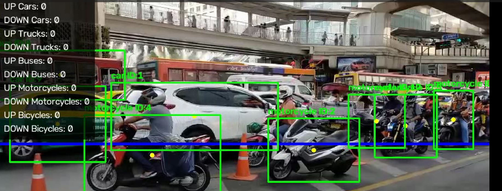
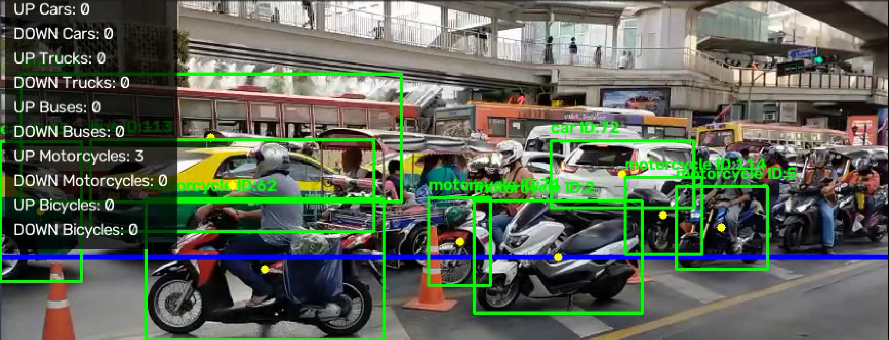
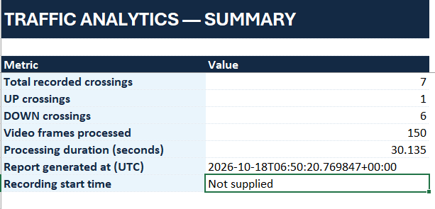
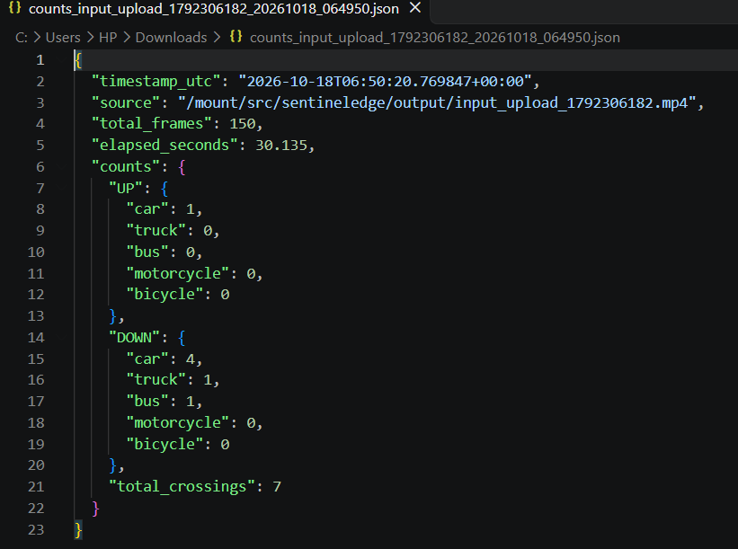

# SentinelEdge – Smart Traffic Analytics

**Physical AI system that sees traffic, decides counts, and acts through data.**

| | |
|---|---|
| **Author** | Zaheer Rachakula |
| **Track** | CraftifAI Physical AI Hackathon – Track A (Perception) |
| **Live demo** | https://zaheer-traffic-analyzer.streamlit.app/ |
| **Problem** | Traffic & Crosswalk Analytics – live per-class UP/DOWN vehicle counts crossed traffic signals |

## Preview

### Image 1


### Image 2


### Image 3


### Image 4


---

## Table of contents

1. [About this project](#1-about-this-project)
2. [Project status](#2-project-status)
3. [How it works (explained)](#3-how-it-works-explained)
4. [Tech stack](#4-tech-stack)
5. [Build process](#5-build-process)
6. [Requirements](#6-requirements)
7. [Setup & commands (Windows + WSL)](#7-setup--commands-windows--wsl)
8. [How to use the app](#8-how-to-use-the-app)
9. [PipeGen setup later (GPU path)](#9-pipegen-setup-later-gpu-path)
10. [Repository layout](#10-repository-layout)
11. [Configuration](#11-configuration)
12. [Actionable outputs](#12-actionable-outputs)
13. [Submission](#13-submission)
14. [Author](#14-author)

---

## 1. About this project

**SentinelEdge** is a traffic analytics system built for the CraftifAI Physical AI Hackathon (Track A – Perception).

### The problem

Cities and roads often have cameras, but those cameras usually only show video. They do not automatically count vehicles by type and direction in real time. Manual counting is slow and error-prone. Without structured counts, it is hard to:

- Measure congestion by direction
- Plan signals or lanes
- Trigger alerts or physical actions (lights, barriers, logs)

### What SentinelEdge does

It turns a **video file**, **webcam**, or **CCTV/RTSP stream** into:

1. **Detection** – finds cars, trucks, buses, motorcycles, bicycles
2. **Tracking** – keeps the same ID on each vehicle as it moves
3. **Counting** – when a vehicle crosses a virtual line, counts it as **UP** or **DOWN** by class
4. **Output** – annotated video, JSON counts, optional MQTT messages, and a web dashboard with Excel export

### Why it matters for Physical AI

Physical AI systems **see → decide → act**.  
SentinelEdge implements the **see** and **decide** stages (vision + counts) and exposes **act**-ready outputs (JSON + MQTT) so a FirmGen board or other system can react (Closed Loop).

### Two paths

| Path | What it is | When to use |
|------|------------|-------------|
| **CPU / dashboard path** | Python + YOLOv8 + Streamlit | Works now on any PC; demo and development |
| **PipeGen / GPU path** | CraftifAI PipeGen → TensorRT → DeepStream | Official Track A edge deployment on NVIDIA GPU / Jetson |

Live demo (CPU path): **https://zaheer-traffic-analyzer.streamlit.app/**

---

## 2. Project status

| Component | Status |
|-----------|--------|
| Vehicle detection (YOLOv8) | Completed |
| Multi-object tracking (ByteTrack) | Completed |
| Directional UP / DOWN line counting | Completed |
| Annotated video + JSON counts | Completed |
| MQTT counts publisher | Completed |
| Streamlit intelligence dashboard | Completed & deployed |
| Excel export | Completed |
| Live public demo | Completed – https://zaheer-traffic-analyzer.streamlit.app/ |
| PipeGen requirement text | Ready (`PIPEGEN_REQUIREMENT.md`) |
| PipeGen TensorRT + DeepStream export | Run on NVIDIA GPU machine |
| Pipeline IR + TensorRT evidence | Add after GPU run into `evidence/` |

---

## 3. How it works (explained)

### Pipeline flow

```text
Input (video file / webcam / RTSP)
        |
        v
+-------------------+
|  YOLOv8 detector  |  Finds vehicles -> boxes, class, confidence
+---------+---------+
          |
          v
+-------------------+
|  ByteTrack        |  Links boxes across frames -> stable track IDs
+---------+---------+
          |
          v
+-------------------+
|  Line counter     |  Centroid crosses horizontal line? -> UP or DOWN
+---------+---------+
          |
          +-------------+-------------+-------------+
          v             v             v             v
   Annotated frame  JSON counts   MQTT topic   Streamlit UI
   (boxes + line +  (UP/DOWN per  traffic/     + Excel
    count panel)     class)        counts
```

### Counting rule (simple)

- A **blue horizontal line** is drawn across the frame (default about 55% down from the top).
- Each tracked vehicle has a **centroid** (center of its box).
- If the centroid moves from **above the line to below** → count **DOWN**.
- If it moves from **below the line to above** → count **UP**.
- Each track ID is counted **only once** (no double counting).

### What you see on screen

- Green bounding boxes
- Class name + track ID (e.g. `car ID:12`)
- Blue counting line
- Top-left panel, for example:

```text
UP Cars: 3
DOWN Cars: 12
UP Trucks: 0
DOWN Trucks: 2
```

That matches the reference traffic-analytics overlay style used in demos.

---

## 4. Tech stack

| Layer | Technology | Role |
|-------|------------|------|
| Detection | Ultralytics YOLOv8 (`yolov8n.pt`) | Detect vehicles in each frame |
| Tracking | ByteTrack (via `model.track`) | Stable IDs over time |
| Vision I/O | OpenCV | Read streams, draw, write MP4 |
| Counting | `src/counter.py` | Line-crossing UP/DOWN logic |
| Visualization | `src/visualizer.py` | Boxes, line, count panel |
| Messaging | paho-mqtt | Publish to `traffic/counts` |
| Dashboard | Streamlit (`app.py`) | Web UI + Excel export |
| Config | PyYAML (`config.yaml`) | Thresholds, line position, classes |
| Edge target | CraftifAI PipeGen → TensorRT → DeepStream | GPU / Jetson production path |

**Python packages** (`requirements.txt`):

```text
ultralytics>=8.3.0
opencv-python-headless>=4.8.0
numpy>=1.24.0
torch>=2.0.0
torchvision>=0.15.0
PyYAML>=6.0
tqdm>=4.65.0
paho-mqtt>=2.0.0
streamlit>=1.40,<2
openpyxl>=3.1.0
lap>=0.5.12
```

---

## 5. Build process

1. Chose official problem: **Traffic and Crosswalk Analytics**.
2. Built a **reference pipeline**: YOLOv8 → ByteTrack → custom line counter → OpenCV overlays.
3. Added **actionable outputs**: annotated MP4, JSON, MQTT.
4. Built a **Streamlit dashboard** and deployed it.
5. Wrote a full **PipeGen requirement** so the same idea can be compiled to TensorRT/DeepStream on GPU.
6. Documented setup for **Windows**, **WSL**, and **PipeGen**.

---

## 6. Requirements

### CPU path (works now)

| Requirement | Notes |
|-------------|--------|
| Python 3.10+ | 3.11 recommended |
| pip + venv | Isolated install |
| ~2 GB free disk | Model download on first run |
| Optional CUDA GPU | Faster; CPU is fine for demos |
| Input | Video file, webcam, or RTSP URL |

### PipeGen GPU path (Track A full criteria)

| Requirement | Notes |
|-------------|--------|
| NVIDIA GPU | Driver **≥ 560.35** |
| Docker | PipeGen runs in a DeepStream container |
| NVIDIA Container Toolkit | GPU inside container |
| socat | Required by launcher |
| User in `docker` group | Avoid constant sudo |
| Graphical session | Live display |
| Disk | ~50 GB free on x86_64 |
| OS | Linux x86_64, Jetson (JetPack 6+), or WSL2 with GPU |

---

## 7. Setup & commands (Windows + WSL)

### 7.1 Windows PowerShell

```powershell
# Go to project (change path if needed)
cd C:\Users\HP\Downloads\SentinelEdge-main

# Create virtual environment
python -m venv venv

# Activate (PowerShell)
.\venv\Scripts\Activate.ps1

# If execution policy blocks activation:
# Set-ExecutionPolicy -Scope CurrentUser RemoteSigned

# Install packages
pip install -r requirements.txt

# Run CLI pipeline (interactive: video / webcam / RTSP)
python main.py

# OR run dashboard locally
streamlit run app.py
```

Non-interactive CLI examples (PowerShell):

```powershell
python main.py --mode video --source "C:\Videos\traffic.mp4"
python main.py --mode webcam --source 0
python main.py --mode rtsp --source "rtsp://192.168.1.10:554/live"
```

### 7.2 WSL (Ubuntu)

```bash
# Go to project – if files are under Windows Downloads:
cd /mnt/c/Users/HP/Downloads/SentinelEdge-main

# Or if you cloned inside WSL home:
# cd ~/SentinelEdge

python3 -m venv venv
source venv/bin/activate

pip install -r requirements.txt

python main.py
# or
streamlit run app.py
```

Non-interactive CLI examples (WSL):

```bash
python main.py --mode video --source /mnt/c/Videos/traffic.mp4
python main.py --mode webcam --source 0
python main.py --mode rtsp --source "rtsp://192.168.1.10:554/live"
```

### 7.3 Git (Windows or WSL)

```bash
cd /path/to/SentinelEdge-main

git init
git add .
git branch -M main
git commit -m "SentinelEdge: traffic analytics, dashboard, docs"

# Create empty repo on GitHub, then:
git remote add origin https://github.com/YOUR_USERNAME/SentinelEdge.git
git push -u origin main
```

### 7.4 Live demo (no install)

Open in any browser:

**https://zaheer-traffic-analyzer.streamlit.app/**

---

## 8. How to use the app

### CLI (`main.py`)

1. Run `python main.py`.
2. Choose input:
   - **1** – path to a video file
   - **2a** – device webcam (index, usually `0`)
   - **2b** – CCTV RTSP URL
3. A window shows annotated video. Press **`q`** to stop.
4. Check `output/` for:
   - `annotated_*.mp4`
   - `counts_*.json`

### Streamlit dashboard (`app.py` or live URL)

1. Local: `streamlit run app.py`
2. Or open https://zaheer-traffic-analyzer.streamlit.app/
3. Upload / process traffic video, view counts, export Excel.

### MQTT (optional)

`src/mqtt_publisher.py` can publish counts to topic **`traffic/counts`**.  
Use this later with a FirmGen board for Closed Loop (physical action when thresholds are hit).

---

## 9. PipeGen setup later (GPU path)

Use this when you have an NVIDIA GPU machine and need the official Track A artifacts.

### 9.1 Machine prep (Linux / WSL2 with GPU)

```bash
# Driver check
nvidia-smi

# Docker (if needed) – follow https://docs.docker.com/engine/install/
# NVIDIA Container Toolkit – follow NVIDIA install guide
sudo apt update
sudo apt install -y socat
sudo usermod -aG docker $USER
newgrp docker
```

Log out and back in after adding the docker group.

### 9.2 Install PipeGen

1. Open https://developer.craftifai.com/dashboard?tab=downloads
2. Sign in → download **PipeGen v0.5.x**
3. Install per official Installation Guide
4. Verify:

```bash
pipegen --version
# expect 0.5.1 (or organizer version)
```

### 9.3 Build the pipeline inside PipeGen

1. Run `pipegen` and sign in.
2. Create a new project.
3. Paste the **entire** content of `PIPEGEN_REQUIREMENT.md` into the Requirement stage.
4. Finish all five stages:

| Stage | Action |
|-------|--------|
| Requirement | Paste text → Generate Pipeline IR |
| Pipeline IR | Review node graph |
| Model | Compile to TensorRT (FP16 or INT8) |
| Compiler | Compile Pipeline |
| Run | Live video / USB / RTSP – results on screen |

5. **Export** the project → copy the folder into `pipegen_export/`.
6. Screenshots:
   - Pipeline IR graph → `evidence/pipeline_ir.png`
   - TensorRT speed report → `evidence/tensorrt_speed_report.png`
7. Push:

```bash
git add pipegen_export/ evidence/
git commit -m "Add PipeGen export and TensorRT evidence"
git push origin main
```

---

## 10. Repository layout

```text
SentinelEdge/
├── README.md
├── PROJECT_DESCRIPTION.md
├── PIPEGEN_REQUIREMENT.md      ← paste into PipeGen
├── SUBMISSION_CHECKLIST.md
├── VERIFICATION_STATUS.md
├── requirements.txt
├── config.yaml
├── main.py                     ← CLI pipeline
├── app.py                      ← Streamlit dashboard
├── src/
│   ├── counter.py
│   ├── visualizer.py
│   └── mqtt_publisher.py
├── evidence/                   ← IR + TensorRT screenshots
├── pipegen_export/             ← PipeGen export folder
├── output/
└── docs/
```

---

## 11. Configuration

Edit `config.yaml`:

| Section | Examples | Meaning |
|---------|----------|---------|
| `model` | `name`, `confidence`, `device` | Weights, threshold, cuda/cpu |
| `classes.vehicle` | car, truck, bus, … | Classes to count |
| `counting` | `line_position` (0–1) | Height of counting line |
| `display` | colors, thickness | Overlay style |
| `output` | `save_annotated`, `mqtt_topic` | Files and MQTT |

---

## 12. Actionable outputs

| Output | Description |
|--------|-------------|
| Live display | Boxes, IDs, line, counts |
| Annotated MP4 | Saved under `output/` |
| JSON counts | UP/DOWN totals per class |
| MQTT | Topic `traffic/counts` |
| Streamlit + Excel | Dashboard and spreadsheet |

---

## 13. Submission

| Item | Link |
|------|------|
| Live demo | https://zaheer-traffic-analyzer.streamlit.app/ |
| Project form | https://forms.gle/eJyeCKCG2UH757QZ8 |
| PipeGen downloads | https://developer.craftifai.com/dashboard?tab=downloads |

In the form, include:

- GitHub repository URL
- Live demo URL: https://zaheer-traffic-analyzer.streamlit.app/

---

## 14. Author

**Zaheer Rachakula**  
CraftifAI Physical AI Hackathon – Track A (Perception)

Live demo: **https://zaheer-traffic-analyzer.streamlit.app/**
